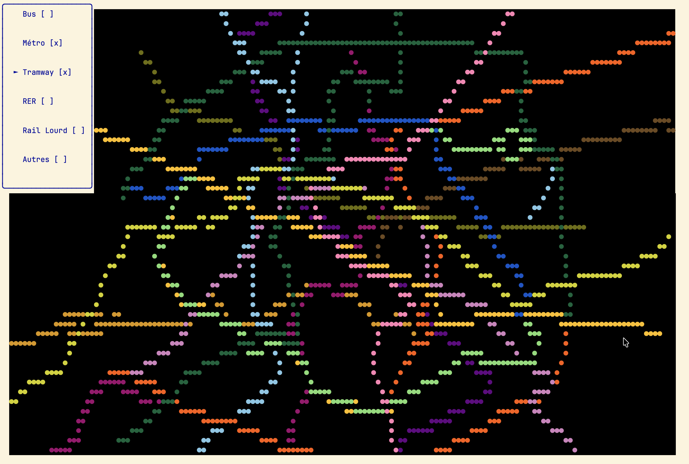
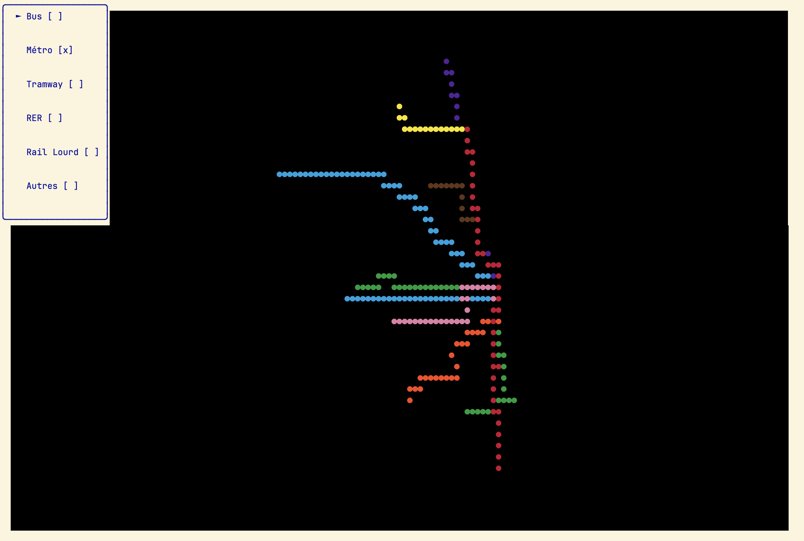
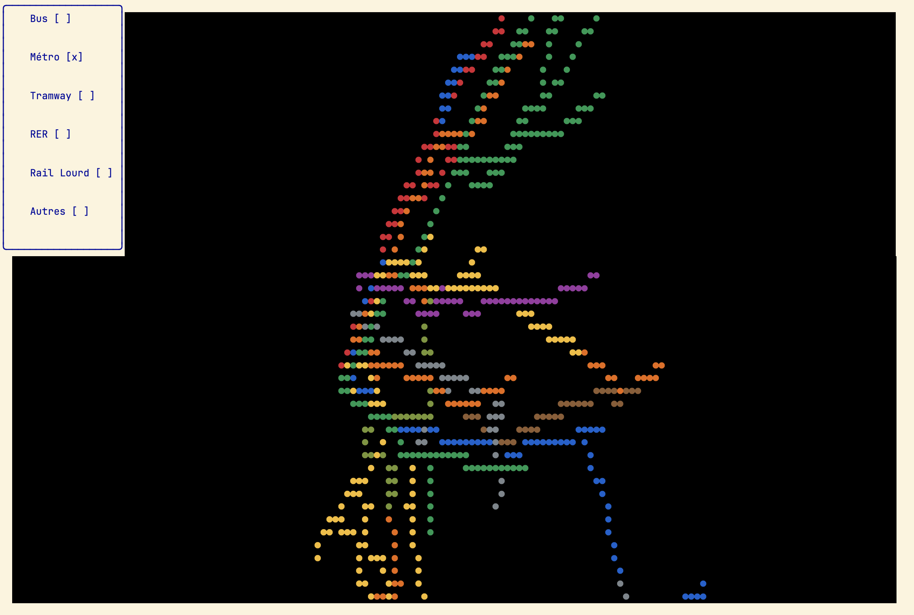

```text
 ___ ____  _____ __  __   _____ _   _ ___ 
|_ _|  _ \|  ___|  \/  | |_   _| | | |_ _|
 | || | | | |_  | |\/| |   | | | | | || | 
 | || |_| |  _| | |  | |   | | | |_| || | 
|___|____/|_|   |_|  |_|   |_|  \___/|___|
```
# GTFS-based transit network viewer and RAPTOR itinerary router

An offline, transit system navigator written in C. Combines a custom terminal map engine with the RAPTOR algorithm for timetable routing.



## Installation & Build

```bash
# Ubuntu/Debian
sudo apt install libnotcurses-dev

# macOS
brew install notcurses

# Build & run
make && ./main
```

## Running Different Networks

Use the interactive GTFS downloader to fetch and preview official feeds from around the world:

```bash
# Browse & download GTFS networks (requires fzf)
./scripts/fetch_gtfs.sh

# Run idfm-tui with a specific feed
./main -d data/gtfs_mdb-389_Chicago_Illinois
```

## Features

- **RAPTOR Algorithm** (*Round-Based Public Transit Routing*)
  - Searches the fastest route with for a defined number of connections.
- **Terminal UI Architecture**
  - Built with **Notcurses**.
  - Multithreaded architecture separating the UI event loop from background worker logic via IPC pipes.
- **Custom Map Engine**
  - **Liang-Barsky** polyline clipping against the terminal viewport bounding box.
  - **Bresenham** line rasterization adapted to terminal cell aspect ratios.
  - Sub-segment trip cutting to accurately trace active transit legs.

---

### Demos

#### Paris Transit Map (IDFM)


#### Interactive GTFS Feed Browser


---

### Multi-City Examples

| Chicago (CTA) | New York (MTA) |
| :---: | :---: |
|  |  |
